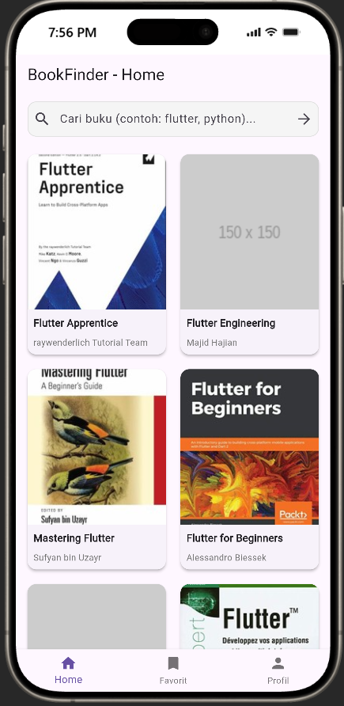
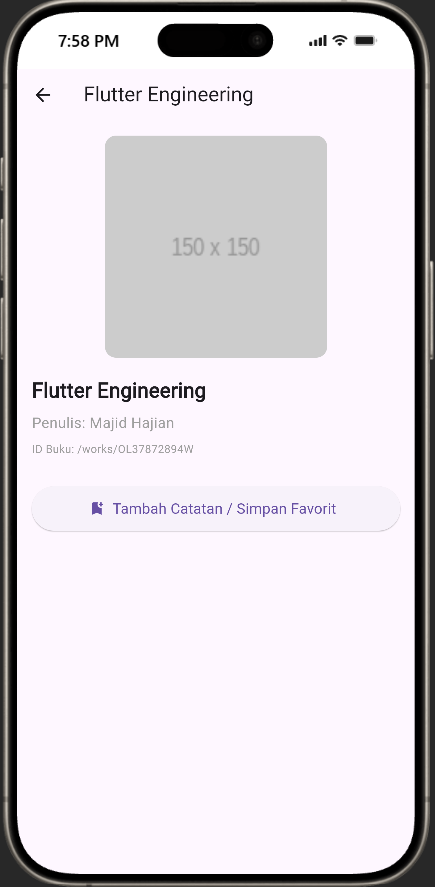
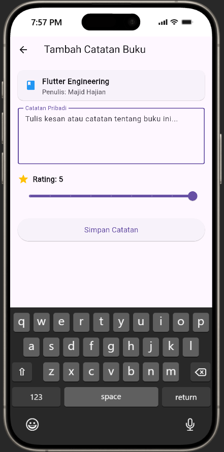
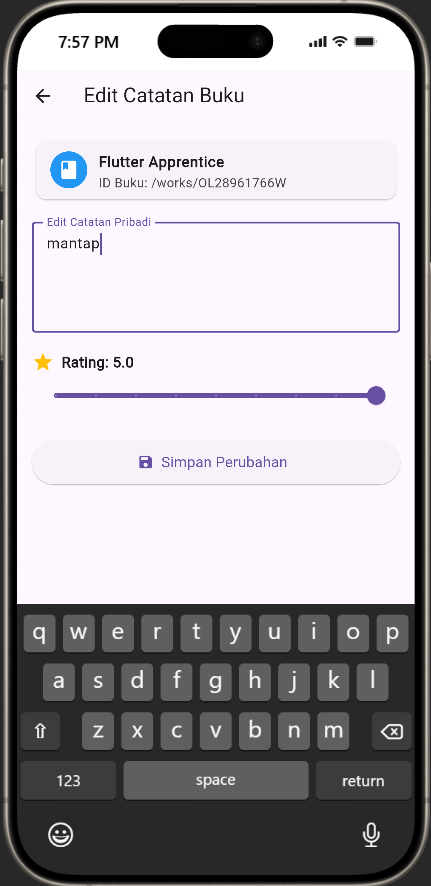
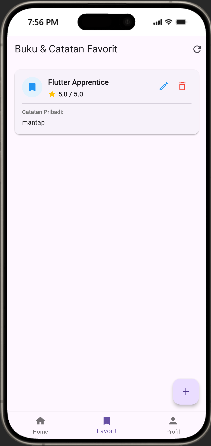
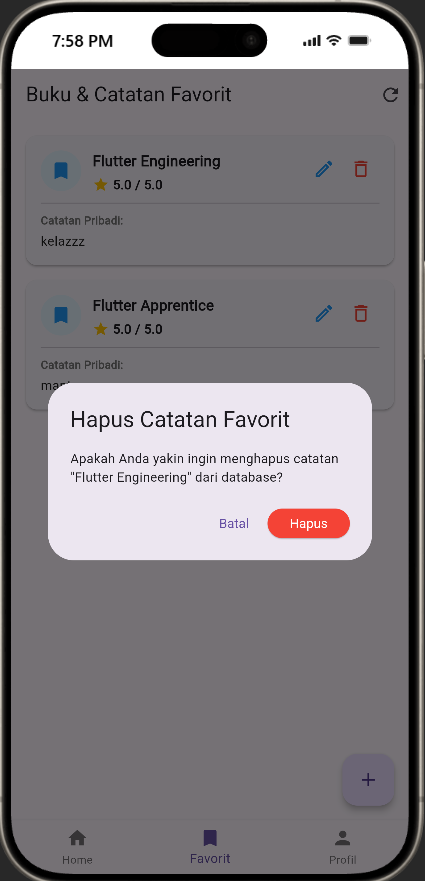
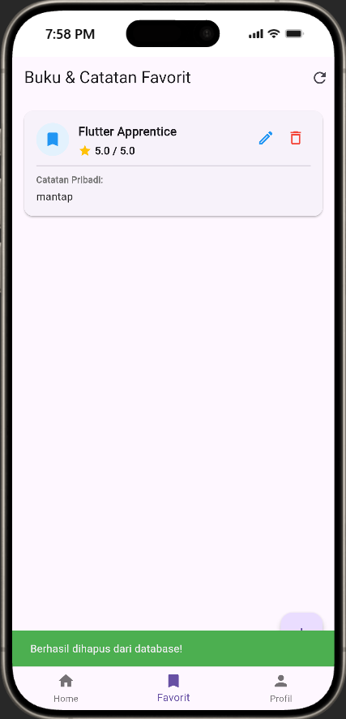
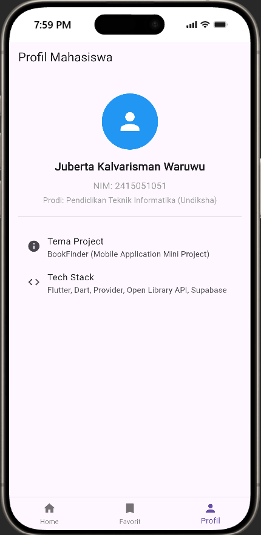

# BookFinder - Mobile Application Mini Project (UTS)

Aplikasi mobile berbasis Flutter untuk pencarian katalog buku dunia dan pengelolaan catatan serta rating buku favorit secara personal. Project ini dibangun untuk memenuhi kriteria evaluasi **Ujian Tengah Semester (UTS) Mata Kuliah Pemrograman Mobile**.

---

## 👤 Identitas Pengembang
* **Nama** : Juberta Kalvarisman Waruwu
* **NIM** : 2415051051
* **Program Studi** : Pendidikan Teknik Informatika
* **Universitas** : Universitas Pendidikan Ganesha (Undiksha)
* **Dosen Pengampu** : Dr. Ir. I Ketut Resika Arthana, S.T., M.Kom.
* **Teaching Assistant** : Made Yuda Sadewa, S.Pd.

---

## 🌟 Daftar Fitur Aplikasi
1. **Dashboard & Katalog Buku (REST API)**:
   - Menampilkan daftar katalog buku secara dinamis dari Open Library.
   - Fitur pencarian buku (*search bar*) berdasarkan kata kunci (*query*).
   - Penanganan *Loading State*, *Error State* (dengan tombol Coba Lagi), dan *Empty State*.
   - *Pull-to-Refresh* untuk memperbarui data katalog.
2. **Layout Responsif**:
   - Mendukung 2 mode tampilan (Compact untuk smartphone [2 kolom], Wide/Expanded untuk tablet [4 kolom]).
3. **Detail Buku**:
   - Menampilkan sampul resolusi medium, judul lengkap, penulis, dan ID buku.
   - Navigasi mulus (*passing data*) ke form penambahan catatan.
4. **Pengelolaan Catatan & Rating Pribadi (Database CRUD)**:
   - **Create**: Menambah buku dan catatan ulasan beserta slider rating (1.0 - 5.0) ke database Supabase.
   - **Read**: Menampilkan daftar buku favorit beserta rating bintang dan catatan ulasan.
   - **Update**: Mengedit ulasan/catatan dan rating buku yang sudah tersimpan di database.
   - **Delete**: Menghapus catatan buku dari database dilengkapi dengan **Dialog Konfirmasi** (*Confirmation AlertDialog*).
5. **Form Validation & User Feedback**:
   - Validasi input form (tidak boleh kosong).
   - Notifikasi interaktif via `SnackBar` untuk setiap aksi berhasil/gagal.
6. **Profil Pengembang & Info Aplikasi**:
   - Halaman profil mahasiswa dan informasi teknologi yang digunakan.

---

## 🛠️ Tech Stack & Dependencies
* **Framework**: Flutter (Dart SDK ^3.13.3)
* **State Management**: `provider: ^6.1.2` (ChangeNotifier)
* **HTTP Client**: `http: ^1.2.0`
* **Cloud Database / BaaS**: `supabase_flutter: ^2.6.0` (PostgreSQL)
* **Icons**: `cupertino_icons: ^1.0.8` & Material Icons

---

## 🌐 Sumber Data & Layanan Eksternal
1. **REST API**:
   - **Provider**: Open Library API (`https://openlibrary.org/search.json?q={query}`)
   - **Operasi**: HTTP GET (Mengembalikan response JSON yang diparsing ke Dart Model `Book`).
2. **Backend & Database**:
   - **Platform**: Supabase Cloud Database (PostgreSQL).
   - **Tabel**: `saved_books`
   - **Struktur Kolom**:
     - `id` (Primary Key, int8 / auto-increment)
     - `book_id` (text / string)
     - `book_title` (text / string)
     - `note` (text)
     - `rating` (float8 / numeric)
     - `created_at` (timestamptz)

---

## 🏛️ Arsitektur Aplikasi
Aplikasi mengadopsi prinsip *Clean Architecture* dan pemisahan tanggung jawab (*Separation of Concerns*):
```
lib/
├── models/                     # Representasi data (Dart Data Models)
│   ├── book_model.dart         # Model data buku dari REST API Open Library
│   └── saved_book_model.dart   # Model data buku & catatan dari Supabase
├── services/                   # Interaksi jaringan langsung (Network calls)
│   └── api_service.dart        # HTTP Client untuk Open Library API
├── repositories/               # Abstraksi sumber data (Data source abstraction)
│   ├── book_repository.dart    # Repositori API
│   └── book_supabase_repository.dart # Repositori Database Supabase
├── providers/                  # State Management (Logika bisnis & notifikasi UI)
│   └── book_provider.dart      # Provider tunggal untuk API dan Database state
├── screens/                    # Halaman / Screen Antarmuka Pengguna
│   ├── main_navigation.dart    # Shell navigasi utama (BottomNavigationBar)
│   ├── home_screen.dart        # Screen 1: Dashboard katalog buku & search
│   ├── book_detail_screen.dart # Screen 2: Detail informasi buku
│   ├── add_edit_note_screen.dart # Screen 3: Form tambah catatan baru
│   ├── edit_note_screen.dart   # Screen 4: Form edit catatan tersimpan
│   ├── favorites_screen.dart   # Screen 5: Daftar buku favorit & catatan database
│   └── profile_screen.dart     # Screen 6: Profil pengembang
└── widgets/                    # Reusable UI Components
    ├── book_card.dart          # Komponen kartu buku katalog
    ├── saved_book_card.dart    # Komponen kartu buku ulasan tersimpan
    └── custom_search_bar.dart  # Komponen bilah pencarian kustom
```

**Alur Data**:
`UI (Screens/Widgets) ➡️ State Management (BookProvider) ➡️ Repositories ➡️ Services / Supabase ➡️ Remote Server`

---

## 📱 Screenshot Aplikasi

* **Home / Catalog (Mobile & Tablet Responsive Grid)**
<p align="center">
  
</p>
* **Detail Buku**
<p align="center">
  
</p>
* **Form Tambah Catatan & Rating**
<p align="center">
  
</p>
* **Form Edit Catatan**
<p align="center">
  
</p>
* **Daftar Catatan Favorit (Supabase)**
<p align="center">
  
</p>
* **Dialog Konfirmasi Hapus & SnackBar Feedback**
<p align="center">
  
  
</p>
* **Profil Pengembang**
<p align="center">
  
</p>


---

## 🚀 Cara Menjalankan Project

1. **Prasyarat**:
   - Pastikan Flutter SDK sudah terpasang (`flutter doctor`).
   - Clone repository ini:
     ```bash
     git clone https://github.com/jubkalll/uts_2415051051_juberta.git
     cd uts_2415051051_juberta
     ```

2. **Instalasi Dependencies**:
   ```bash
   flutter pub get
   ```

3. **Menjalankan Aplikasi**:
   ```bash
   flutter run
   ```

4. **Build APK**:
   ```bash
   flutter build apk --release
   ```
   File APK output akan berada di: `UTS_2415051051_Juberta.apk`.
